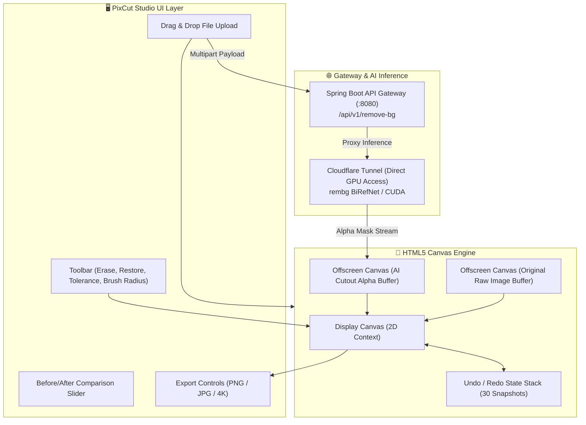

# 🎨 PixCut Studio — Web-Based AI Background Remover & Magic Erase Canvas

[](https://developer.mozilla.org/en-US/docs/Web/JavaScript)
[](https://developer.mozilla.org/en-US/docs/Web/API/Canvas_API)
[](https://developer.mozilla.org/en-US/docs/Web/CSS)
[](react-component/)
[](https://vercel.com/)
[](https://github.com/mdsufidev/bgremover/actions)
[](LICENSE)

> A modern, ultra-responsive web studio and HTML5 Canvas application for AI-powered background removal, pixel-perfect manual touch-ups (Magic Erase & Magic Restore), interactive before/after split comparisons, and 4K ultra-high-definition exports.

---

## 📑 Table of Contents

- [Overview](#-overview)
- [Key Features](#-key-features)
- [Client-Side Architecture](#-client-side-architecture)
- [Interactive Studio Tools](#-interactive-studio-tools)
- [Reusable React Component](#-reusable-react-component)
- [Project Structure](#-project-structure)
- [Getting Started](#-getting-started)
  - [Prerequisites](#prerequisites)
  - [Running Locally](#running-locally)
  - [Deploying to Production](#deploying-to-production)
- [Configuration & API Endpoints](#-configuration--api-endpoints)
- [Contributing](#-contributing)
- [License](#-license)
- [Author](#-author)

---

## 💡 Overview

**PixCut Studio** is engineered as a lightweight, zero-dependency browser client that communicates seamlessly with high-performance AI inference backends (Python FastAPI / BiRefNet) or an enterprise API gateway ([PixCut Spring Boot Backend](https://github.com/mdsufidev/bgremoverbackend)).

Unlike basic background removers that return a static transparent image, PixCut Studio provides an **interactive editing suite** directly in the browser: users can fine-tune hair strands, erase stubborn background artifacts with a tolerance-aware flood-fill brush, or restore accidentally cut foreground pixels from the un-cut original photo.

---

## 🌟 Key Features

1. **⚡ GPU-Accelerated AI Removal:** Integrates with local or remote NVIDIA CUDA microservices exposed via high-speed Cloudflare tunnels for sub-second cutouts.
2. **🪄 On-Click Magic Erase (Chroma Flood-Fill):** Click or drag across unwanted background remnants with a tunable tolerance slider ($0\text{--}100$) to cleanly strip remaining color fringes.
3. **✨ On-Click Magic Restore:** Dual-buffer blending allows users to paint over over-clipped areas to restore pristine pixels directly from the original source image.
4. **🔍 Interactive Split Comparison Slider:** Smooth draggable split-screen divider to inspect cut precision and edge crispness against the original image in real-time.
5. **🎨 Dynamic Background Replacement:**
   - Pure Transparent Alpha Channel (PNG)
   - Solid Color Palette & Hex Picker
   - Gaussian Blur Original Backdrop
   - Custom High-Resolution Background Photo Upload
6. **↩️ Deep Undo/Redo Engine:** Up to 30 sequential states stored using memory-efficient pixel buffers, preventing canvas degradation and memory leaks.
7. **💎 4K Resolution & Admin VIP:** Supports standard exports as well as 4K Ultra-HD downloads, with administrative email bypass (`sufi11729@gmail.com`).
8. **📦 Reusable React Component:** Includes a standalone, plug-and-play JSX component ready to drop into modern Next.js and Vite applications.

---

## 🏛️ Client-Side Architecture



---

## 🛠️ Interactive Studio Tools

| Tool | Mode | Description |
| :--- | :--- | :--- |
| **Magic Erase** | `erase` | Flood-fills and removes contiguous color pixels matching target RGB within user-defined tolerance. |
| **Magic Restore** | `restore` | Blends pixels from the original un-cut raw image buffer back into the canvas to recover accidentally erased subjects. |
| **Brush Radius** | Slider ($4\text{px} \text{--} 64\text{px}$) | Controls the circular brush mask diameter for manual retouching. |
| **Tolerance** | Slider ($0 \text{--} 100$) | Controls Euclidean color distance threshold for magic flood-fill eradication. |
| **Split Slider** | Toggle | Overlays the original and transparent cutout with an interactive sliding partition. |

---

## ⚛️ Reusable React Component

For modern React, Next.js, or Vite applications, this repository includes an enterprise-ready, modular React component in [`react-component/`](react-component/):

```jsx
import React from 'react';
import MagicEraseStudio from './react-component/MagicEraseStudio';

export default function App() {
  const handleSave = (imageBlob) => {
    console.log("Processed image ready for upload:", imageBlob);
  };

  return (
    <div className="w-full h-screen">
      <MagicEraseStudio 
        apiEndpoint="https://remote-motherboard-olympus-ron.trycloudflare.com/remove-bg"
        onSave={handleSave}
      />
    </div>
  );
}
```

---

## 📁 Project Structure

```bash
bgremover/
├── .github/
│   └── workflows/
│       └── ci.yml               # GitHub Actions CI validation workflow
├── react-component/
│   ├── MagicEraseStudio.jsx     # Drop-in React 18+ Studio Component
│   └── example-usage.jsx        # Implementation demo and props documentation
├── app.js                       # Core canvas processing, state machine, and API client
├── index.html                   # Studio web application HTML5 layout
├── style.css                    # Clean Swiss modern styling and glassmorphism UI
├── serve.py                     # Zero-dependency Python local HTTP server
├── vercel.json                  # 1-Click Vercel deployment routing configuration
├── package.json                 # Node package configuration and npm scripts
├── CONTRIBUTING.md              # Open source contribution guidelines
├── SECURITY.md                  # Vulnerability disclosure policy
├── LICENSE                      # MIT Open Source License
└── README.md                    # Project documentation
```

---

## 🚀 Getting Started

### Prerequisites
- Any modern web browser (Google Chrome, Firefox, Safari, Microsoft Edge).
- (Optional) [Python 3.8+](https://www.python.org/) or [Node.js 18+](https://nodejs.org/) for local preview serving.

### Running Locally

1. **Clone the repository:**
   ```bash
   git clone https://github.com/mdsufidev/bgremover.git
   cd bgremover
   ```

2. **Start the local server:**

   **Using Python:**
   ```bash
   python serve.py
   ```

   **Or using Node.js:**
   ```bash
   npx serve .
   ```

3. **Open in your browser:**
   Navigate to [http://localhost:3000](http://localhost:3000).

---

### Deploying to Production

#### ⚡ Deploy to Vercel (1-Click)
1. Fork or push this repository to your GitHub account.
2. Go to [Vercel](https://vercel.com/) and click **"Add New Project"**.
3. Import `bgremover`.
4. Click **Deploy**. Vercel will automatically detect `vercel.json` and serve the static studio worldwide with edge caching!

#### 🌐 Deploy to Netlify / GitHub Pages
- **GitHub Pages:** Go to **Settings > Pages > Branch: `main` > `/ (root)` > Save**.
- **Netlify:** Drag and drop the repository folder directly into the Netlify dashboard.

---

## 🔧 Configuration & API Endpoints

PixCut Studio automatically connects to either the local Spring Boot gateway or the public Cloudflare GPU tunnel:

| Environment Variable / Constant | Default Value | Purpose |
| :--- | :--- | :--- |
| `API_BASE` | `http://localhost:8080/api/v1` | Spring Boot gateway endpoint for authentication, credits, and metering. |
| `AI_ENGINE_URL` | `https://remote-motherboard-olympus-ron.trycloudflare.com` | High-speed Cloudflare tunnel proxying directly to NVIDIA GPU inference. |

You can also dynamically set the AI Engine URL at runtime via the browser console:
```javascript
window.setAiEngineUrl("https://your-custom-tunnel.trycloudflare.com");
```

---

## 🤝 Contributing

Contributions are warmly welcome! Please read [`CONTRIBUTING.md`](CONTRIBUTING.md) before submitting a Pull Request.

---

## 📄 License

Distributed under the **MIT License**. See [`LICENSE`](LICENSE) for complete details.

---

## 👨‍💻 Author

**Md Sufiyan**  
- GitHub: [@mdsufidev](https://github.com/mdsufidev)  
- Backend API Repository: [mdsufidev/bgremoverbackend](https://github.com/mdsufidev/bgremoverbackend)
